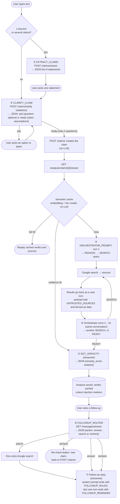
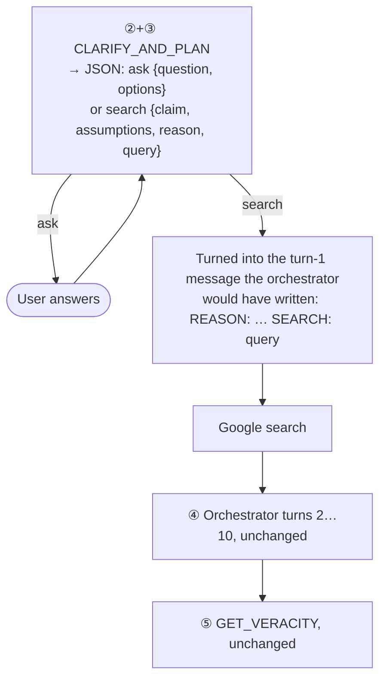

# Prompt map

Which prompt in [prompts.py](../app/core/llm/prompts.py) runs where, in what order, and what it produces. All prompts are attributes of `AnalysisPrompt`. `_FR` versions run instead of the English ones when the claim's language is French.

## The interactive fact-check, stage by stage

What happens when a user types into the chat. Each numbered box is one LLM call (Llama 4 on Vertex unless noted).

**LLM calls before the first word of a verdict, for a clear claim that isn't cached:** ② clarify, then ③ orchestrator turn 1, then usually 1–2 more orchestrator turns (④), then ⑤ verdict. That's 4–5 calls. ② and ③ both read only the raw claim, before any evidence exists.

## Other flows

| Flow | Entry point | LLM calls |
|---|---|---|
| Batch | `POST /claims/batch` → `analyze_claim_direct` | ③ ④ ⑤ only: no extraction, no clarification. Uses Serper instead of Google search |
| Experiment stream | `GET /analysis/experiment/claim/{id}/stream` | ③ ④ ⑤ on Together AI instead of Vertex |
| Assertiveness | `GET /analysis/{id}/assertiveness` | One `HIGH_ASSERT` or `LOW_ASSERT` rewrite of an existing analysis |
| Multi-turn off (`MULTITURN_ENABLED=false`) | same as interactive | ② returns at once without an LLM call; ⑥ is skipped |

## Every prompt

| Prompt | Stage | Called from | Output | In cache key* |
|---|---|---|---|---|
| `EXTRACT_CLAIMS(_FR)` | ① split text into checkable statements | `ClaimExtractionService.extract_statements` | JSON `{"statements": [...]}` | no |
| `CLARIFY_CLAIM(_FR)` | ② ask a question or return the final claim | `ClaimExtractionService.clarify` | JSON ask / ready | no |
| `ORCHESTRATOR_PROMPT(_FR)` | ③ ④ search loop: first user turn, rules for every turn | `AnalysisOrchestrator._query_initial`, used in `_generate_analysis` | Free text: `REASON: … SEARCH: …` or `READY` | **yes** |
| `UNTRUSTED_SOURCES(_FR)` | ③ ④ wraps each set of search results | `AnalysisOrchestrator._evidence_prompt` | (instruction, no output of its own) | no |
| `GET_VERACITY` | ⑤ verdict | `_generate_analysis` (default=True, every live path) | JSON `{veracity_score, analysis}` | **yes** |
| `GET_VERACITY_FR` | ⑤ verdict, French | `_generate_analysis` | same | **yes** |
| `GET_VERACITY_EX` | ⑤ verdict without score talk | `_generate_analysis` when default=False | same | **yes** |
| `FOLLOWUP_ROUTER` | ⑥ choose answer / search / recheck | `AnalysisOrchestrator._route_followup` | JSON `{action, query, claim}` | no |
| `FOLLOWUP_RULES` | ⑦ end of the follow-up system prompt | `stream_claim_discussion` | (instruction) | no |
| `FOLLOWUP_REMINDER` | ⑦ appended to the user's latest message | `stream_claim_discussion` | (instruction) | no |
| `HIGH_ASSERT`, `LOW_ASSERT` | rewrite an analysis more or less assertively | `vary_analysis_assertiveness` | Free text | no |

*Changing a prompt marked "yes" changes `SemanticCacheService.params_hash`, so the cache starts empty.

**Not reached today:**
- `GET_VERACITY_EX` and the log-prob confidence step run only when `default=False`, and no caller passes that.
- `GET_CONFIDENCE` belongs to `_generate_confidence_score`, which nothing calls.
- `GET_ANTH_CONFIDENCE_MOD_2` belongs to `_get_anth_confidence_score`, whose only call is commented out.

**Unused (no callers):** `REMOVE_SOURCES`, `GET_ANTH_CONFIDENCE`, `GET_ANTH_CONFIDENCE_MOD`, `IDEAL_PROMPT`, `SUMMARIZE_SEARCH`, `CLAIM_ANALYSIS`, `CLAIM_ANALYSIS_FRENCH`, `CLAIM_DETECTION`. Candidates for deletion.

## Experiment: one call instead of ② + ③

Calls ② and ③ both run before any evidence exists, and on a clear claim ② decides nothing. The experiment in [tests/eval/combined_prompt.py](../tests/eval/combined_prompt.py) merges them into one call, `CLARIFY_AND_PLAN`. It is not used by the app.

- **Clarification rules:** the prompt contains the live `CLARIFY_CLAIM` rules word for word. They're copied from the live prompt at import time, and a test checks this.
- **Turn-1 duties:** it adds turn 1's duties from `ORCHESTRATOR_PROMPT`: the search tool, today's date, the 0–100 scale, searching at least once, and not relying on prior knowledge.
- **After turn 1:** the search loop continues under the original `ORCHESTRATOR_PROMPT`, so everything after turn 1 is the same code and the same prompts.

Results: [combined-prompt-eval.md](combined-prompt-eval.md).
